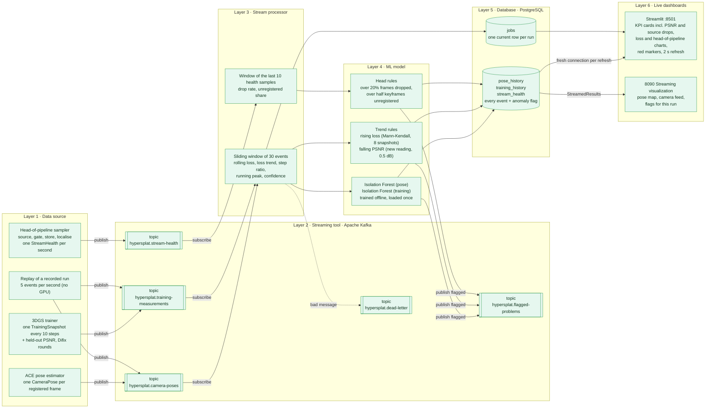
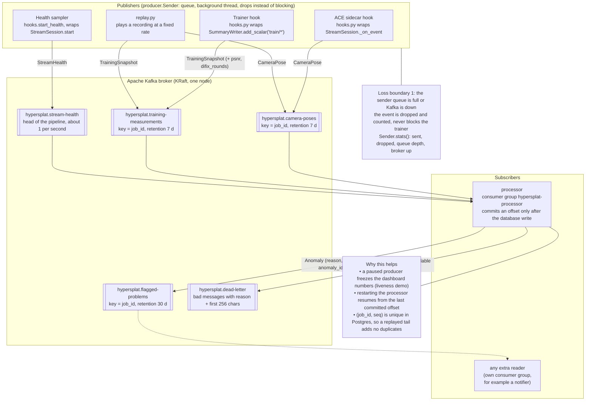
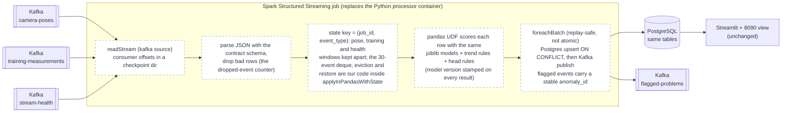
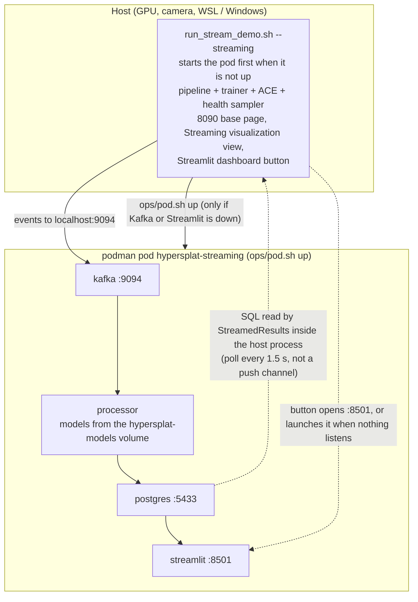
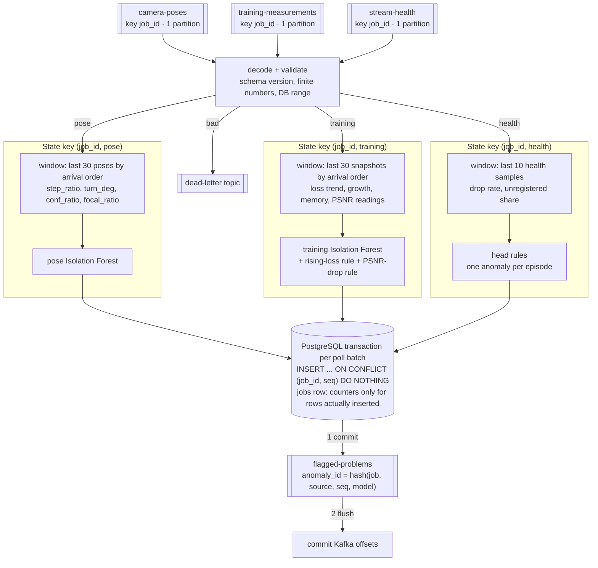
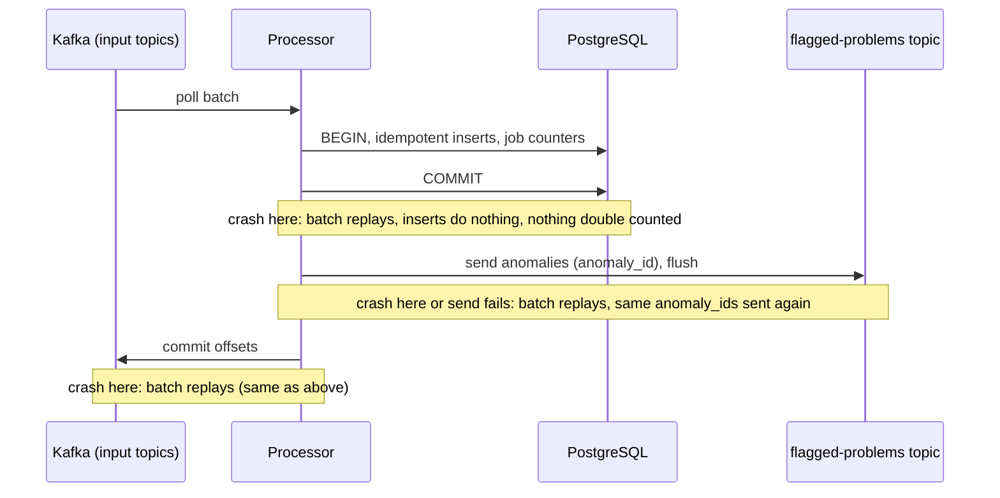

# Streaming architecture: the six layers on Apache Kafka (pub/sub) and Spark

The course guide (Real-Time Streaming Analytics) asks for six layers: data source, streaming tool,
stream processor, ML model, database, live dashboard. This is how HyperSplat fills each one.
Green boxes are built and verified; the dashed Spark box is the alternative processor design and is
**not built yet** (the processor that runs today is plain Python, which the guide allows).

## 1. The six layers at a glance



## 2. Kafka publish / subscribe in detail

Publishers never talk to the processor and the processor never talks to the dashboards. Each side only
knows Kafka (or Postgres), so any part can restart or run at a different speed without losing events.



## 3. The same pipeline with Spark as the stream processor (design, not built)

The guide lists Spark and Flink as alternatives for layer 3. Only the middle changes: Kafka stays the
transport, Postgres stays the serving layer, and the models and dashboards are untouched.



| | Python processor (built) | Spark Structured Streaming (planned) |
|---|---|---|
| Fits | one machine, one job, 5 to 100 events per second | many jobs or higher rates, needs a cluster |
| State | in-memory deques, rebuilt from Postgres on restart | managed state plus a checkpoint |
| Delivery | at-least-once: offset commit after the database write, replay-safe idempotent inserts | at-least-once: checkpoint plus the same idempotent upsert; the two sinks are not one transaction |
| Cost | one small container | a JVM and Spark, much heavier for a course demo |

## 4. Where it runs



## Reading guide

| Layer | Guide's requirement | Built as | Code |
|---|---|---|---|
| 1 Data source | any event stream, paced | hooks on the live run, or a recorded replay | `hooks.py`, `sources.py`, `replay.py` |
| 2 Streaming tool | Kafka, Storm, Spark or Flink | Apache Kafka, 5 named topics | `topics.py`, `producer.py`, `contract.py` |
| 3 Stream processor | live metrics, sliding window | Python, 30-event windows | `processor.py` |
| 4 ML model | at least one algorithm | 2 Isolation Forests, a rising-loss rule, a PSNR-drop rule and head-of-pipeline rules | `train_models.py`, `contract.rising_loss`, `falling_psnr`, `head_alerts` |
| 5 Database | processor writes, dashboard reads | PostgreSQL, three history tables plus one-row snapshot | `contract.DDL` |
| 6 Dashboard | auto-refresh, red markers | Streamlit (8501) and the 8090 view | `dashboard.py`, `hypersplat/stream/dashboard.py` |

## 5. The processor's internal graph (what each edge guarantees)

Pose and training events are processed independently. They are two keyed streams, never one merged
window, so a burst of poses cannot push training snapshots out of their window.



| Edge | Schema / key | State | Delivery | If it fails |
|---|---|---|---|---|
| producer to topic | `CameraPose` / `TrainingSnapshot` / `StreamHealth`, key `job_id`, per-type `seq` | none | at-most-once at the producer queue | event dropped and counted in `Sender.stats()`; the dashboard shows the producer drop counter |
| topic to decode | JSON, `v` schema version | none | at-least-once (offsets commit last) | bad message goes to the dead-letter topic with its reason, the batch continues |
| decode to window | typed event | count-based window per (job, type): 30 poses, 30 snapshots, 10 health samples, ordered by arrival and `seq` | n/a | `seq` at or below the last handled is skipped and counted (`Processor.skipped`), never silent |
| window to Postgres | history row (pose, training or stream_health) plus anomaly flag | rebuilt from the newest 30 history rows on restart | idempotent: unique `(job_id, seq)` per table, counters add only for inserted rows | transaction rolls back, windows are cleared and rebuilt, offsets stay uncommitted, the batch replays |
| Postgres to flagged topic | `Anomaly` with `anomaly_id` | none | at-least-once: sent after the DB commit, flushed before offsets commit | replay re-sends the same `anomaly_id`; consumers dedupe on it |
| flagged topic to offsets | n/a | n/a | n/a | if an anomaly is not delivered, offsets are not committed and the batch is retried |

## 6. Delivery contract, stated exactly



- **What is guaranteed:** every event that reaches Kafka is processed at least once; the history tables
  and job counters end up the same however often a batch replays; a flagged event is always re-sent
  until delivered.
- **What is not guaranteed:** exactly-once across Kafka, PostgreSQL and the output topic. They are
  three systems with no shared transaction, so the flagged-problems topic can contain duplicates. That
  is why every anomaly has a stable `anomaly_id`, and why Postgres is the authoritative store: the
  dashboards read Postgres, not the topic.
- **Where events can still be lost:** before Kafka, when the producer queue is full or the broker is
  down (a deliberate choice so training is never slowed; counted, not hidden).
- **Window semantics:** count-based (the last 30 events of one type for one job), ordered by arrival.
  The loss-trend rule needs 8 consecutive training snapshots, never a mix. Late or duplicate events
  are skipped and counted; there is no event-time watermark because one producer per job on one
  partition keeps order. Switching to event-time windows is the first change a Flink port would make.

## 7. Topology and how it would scale

| Topic | Partitions now | Key | Consumer group | Limit |
|---|---|---|---|---|
| camera-poses | 1 | `job_id` | `hypersplat-processor` | one processor instance reads it; ordering per job is exact |
| training-measurements | 1 | `job_id` | `hypersplat-processor` | same |
| flagged-problems | 1 | `job_id` | none yet | readers are optional |
| dead-letter | 1 | `job_id` | none | inspection only |
| stream-health | 1 | `job_id` | `hypersplat-processor` | about 1 event per second per job; same limit as the other inputs |

To scale, raise partitions to the number of processor replicas and keep `job_id` as the key: jobs
spread across replicas, but one hot job still sits on one partition. Replication factor is 1 and there is
one broker, so a broker failure loses availability and data; this is a demo topology, not an HA one.
The partition-change step needs the processor's rebalance handler (it already clears per-job state on
rebalance and rebuilds from Postgres).

## 8. What the 8090 view reads

The Streaming visualization view does not receive a pushed stream. `StreamedResults` runs a short SQL
query against PostgreSQL (cached 1.5 s, pinned to `HYPERSPLAT_JOB_ID`), so Postgres owns the truth, a
restart of the visualizer loses nothing, and a database outage shows as "waiting for processor results"
with the reason instead of zero flags.

## 9. Operational signals

| Signal | Where |
|---|---|
| producer sent, dropped, queue depth, broker up | `Sender.stats()` |
| consumer lag, events/s, drops, skipped, output queue | processor log line every 10 s (`consumer_lag`) |
| undecodable or out-of-range messages | dead-letter topic and `jobs.events_dropped` |
| liveness and counts | `health.py` and the dashboard header |
| frames dropped at the source, unregistered keyframes, localise latency | `stream_health` table, head rules, Streamlit "Source drops" and "Localize" |

## 10. Next steps from the review (not done)

1. A forced-failure test pass against real Kafka and Postgres: kill the processor between each step of
   the sequence in section 6 and compare the three stores.
2. Make the jobs snapshot update conditional on a newer `seq`, so a replay of an older batch can never
   move `current_step` backwards (today the in-process guard and the history rebuild prevent it).
3. Add `event_id` and a model version to the output event (the version is only in the model file today).
4. Benchmark the Python processor before porting to Spark or Flink; port only for a measured reason.

## 11. Head-of-pipeline health tap (new)

```mermaid
flowchart LR
    subgraph HOST["Host: StreamSession"]
        direction TB
        SRC["frame queue (drops oldest)"] --> GATE["keyframe gate"] --> STORE["keyframe store"] --> ACE["ACE localise"]
        STATS["session.stats()<br/>frames read and dropped, keyframes,<br/>registered and unregistered, evictions,<br/>localise ms, depth rejects, store MB"]
        SRC -.-> STATS
        GATE -.-> STATS
        STORE -.-> STATS
        ACE -.-> STATS
        TAPC(["TAP C · hooks.start_health<br/>started by the wrapped StreamSession.start,<br/>1 sample per second, stops with the session"])
        STATS --> TAPC
    end

    TAPC -- "StreamHealth<br/>cumulative counters, own seq" --> SND["producer queue"] --> KH[["stream-health topic"]]

    subgraph POD["Pod"]
        direction TB
        PH["processor: window of 10 samples"]
        RULE["head rules<br/>over 20% frames dropped<br/>over half of new keyframes unregistered"]
        TBL[("stream_health<br/>INSERT ... ON CONFLICT (job_id, seq) DO NOTHING")]
        AN[["flagged-problems<br/>source health, model head_rules,<br/>one per episode, repeated every 30 samples"]]
        PH --> RULE --> TBL
        RULE --> AN
    end

    KH --> PH
    TBL --> SL["Streamlit: Source drops, Localize,<br/>head-of-the-pipeline chart"]
```



## 12. Start-up and launch from the stream demo (new)

```mermaid
sequenceDiagram
    participant U as run_stream_demo.sh --streaming
    participant L as live.sh
    participant P as ops/pod.sh up
    participant Z as pod (Kafka, Postgres, processor, Streamlit)
    participant B as 8090 button

    U->>L: re-run with the Kafka hooks on
    L->>Z: are Kafka :9094 and Streamlit :8501 answering?
    alt both answer
        Z-->>L: yes, nothing is started
    else one is down (and HYPERSPLAT_NO_POD is not 1)
        L->>P: start the data layers (build image, copy models, kube play)
        P->>Z: pod up, ports open
        Note over L,P: a failure only warns; the run is never blocked
    end
    L->>U: exec the demo with HYPERSPLAT_JOB_ID, tb_every=10
    B->>Z: Streamlit dashboard button: open :8501
    B->>U: if nothing listens, POST /api/launch_streamlit starts dashboard.py on that port
```
