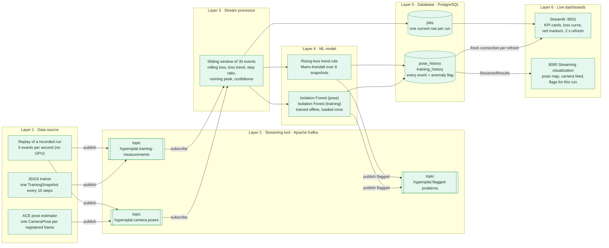
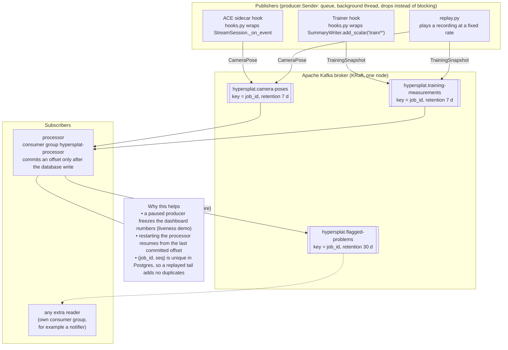
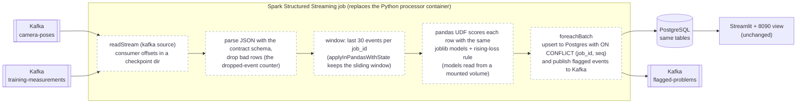
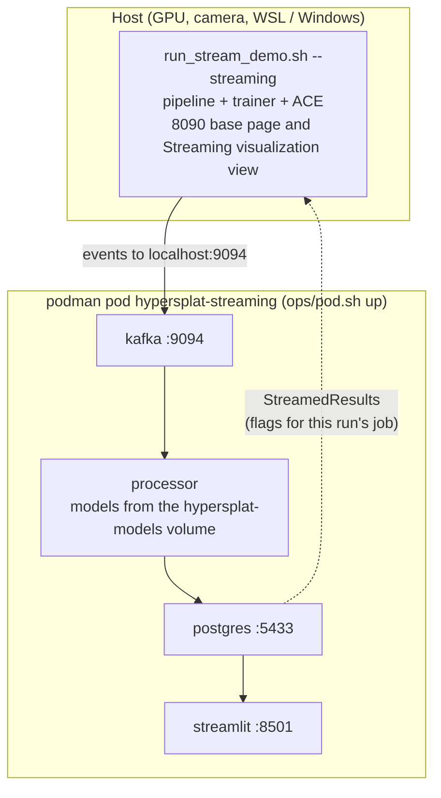

# Streaming architecture: the six layers on Apache Kafka (pub/sub) and Spark

The course guide (Real-Time Streaming Analytics) asks for six layers: data source, streaming tool,
stream processor, ML model, database, live dashboard. This is how HyperSplat fills each one.
Green boxes are built and verified; the dashed Spark box is the alternative processor design and is
**not built yet** (the processor that runs today is plain Python, which the guide allows).

## 1. The six layers at a glance

## 2. Kafka publish / subscribe in detail

Publishers never talk to the processor and the processor never talks to the dashboards. Each side only
knows Kafka (or Postgres), so any part can restart or run at a different speed without losing events.

## 3. The same pipeline with Spark as the stream processor (design, not built)

The guide lists Spark and Flink as alternatives for layer 3. Only the middle changes: Kafka stays the
transport, Postgres stays the serving layer, and the models and dashboards are untouched.

| | Python processor (built) | Spark Structured Streaming (planned) |
|---|---|---|
| Fits | one machine, one job, 5 to 100 events per second | many jobs or higher rates, needs a cluster |
| State | in-memory deques, rebuilt from Postgres on restart | managed state plus a checkpoint |
| Exactly-once | offset commit after the database write, plus `ON CONFLICT DO NOTHING` | checkpoint plus the same idempotent upsert |
| Cost | one small container | a JVM and Spark, much heavier for a course demo |

## 4. Where it runs

## Reading guide

| Layer | Guide's requirement | Built as | Code |
|---|---|---|---|
| 1 Data source | any event stream, paced | hooks on the live run, or a recorded replay | `hooks.py`, `sources.py`, `replay.py` |
| 2 Streaming tool | Kafka, Storm, Spark or Flink | Apache Kafka, 3 named topics | `topics.py`, `producer.py`, `contract.py` |
| 3 Stream processor | live metrics, sliding window | Python, 30-event windows | `processor.py` |
| 4 ML model | at least one algorithm | 2 Isolation Forests plus a rising-loss rule | `train_models.py`, `contract.rising_loss` |
| 5 Database | processor writes, dashboard reads | PostgreSQL, history plus one-row snapshot | `contract.DDL` |
| 6 Dashboard | auto-refresh, red markers | Streamlit (8501) and the 8090 view | `dashboard.py`, `hypersplat/stream/dashboard.py` |
