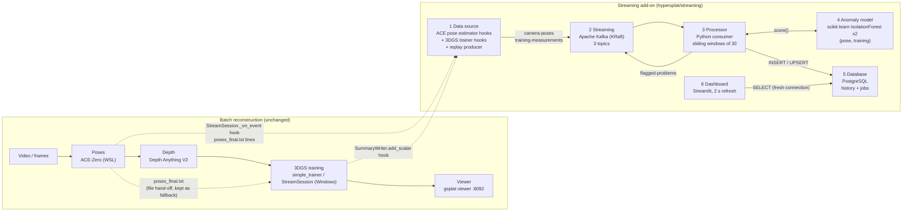

# HyperSplat streaming: architecture

This add-on watches a reconstruction while it runs. It does not change how the reconstruction is
computed. The batch pipeline (video → poses → depth → 3DGS training → viewer) stays as it is.
Small numeric events about poses and training are copied into Kafka, scored by two Isolation
Forests, stored in PostgreSQL and shown in Streamlit.

`hypersplat/streaming/contract.py` defines every name, topic, port, window, feature, table and
layer listed below. This document copies its values. If the two disagree, the contract is correct.

## 1. Six layers beside the batch pipeline (PDF row 1)



The dotted arrows are the only links between the two halves. They are read-only taps. If any
streaming layer is down, the reconstruction still finishes, because sends never block (section 7)
and the file hand-off stays on (`contract.FILE_HANDOFF_ENABLED`).

| Layer | Tool | Entry point (under `hypersplat/streaming/`) |
|---|---|---|
| Data source | ACE pose hooks, 3DGS trainer hooks, replay producer | `hooks.py`, `autohook/sitecustomize.py`, `sources.py`, `replay.py`, `producer.py` |
| Streaming | Apache Kafka (KRaft, single node) | `docker-compose.yml`, `topics.py` |
| Processor | Python consumer with sliding windows | `processor.py` |
| Anomaly model | scikit-learn IsolationForest ×2 | `train_models.py` (offline fit), loaded by `processor.py` |
| Database | PostgreSQL | `docker-compose.yml`, DDL in `contract.DDL` |
| Dashboard | Streamlit | `dashboard.py` |

## 2. Topics (rows 5, 6)

The values come from `contract.TOPICS`. Every topic is keyed by `job_id`, so a job's events stay
in order within a partition. `contract.TOPIC_PREFIX` (default empty) is added before each name
so tests can share one broker.

| Topic | Key | Partitions | Retention | Producer | Consumer | Sample event |
|---|---|---|---|---|---|---|
| `hypersplat.camera-poses` | `job_id` | 1 | 7 days (604800000 ms) | ACE hooks (`hooks.py` via `autohook/sitecustomize.py`), `replay.py` | `processor.py` | `CameraPose`, section 3.1 |
| `hypersplat.training-measurements` | `job_id` | 1 | 7 days (604800000 ms) | trainer hook (`hooks.py`), `replay.py` | `processor.py` | `TrainingSnapshot`, section 3.2 |
| `hypersplat.flagged-problems` | `job_id` | 1 | 30 days (2592000000 ms) | `processor.py` | no in-project consumer (the dashboard reads PostgreSQL); kept for audit and downstream use | `Anomaly`, section 3.3 |

Descriptions in the contract: "one CameraPose per registered frame", "one TrainingSnapshot every
TRAIN_LOG_EVERY steps", "one Anomaly per event the models flag". A single partition per topic is
enough at these rates (well under 100 events/s) and keeps ordering simple. To add more
partitions later, keep `job_id` as the key so per-job ordering still holds.

## 3. Events (row 2)

Each event is a frozen dataclass in the contract. `contract.encode` serializes it to compact
JSON and adds `kind` and `v` (`contract.SCHEMA_VERSION`). `contract.decode` reverses this and
runs `contract.validate`. Unknown keys are ignored, so an older consumer can read events from a
newer producer. Messages larger than `contract.MAX_MESSAGE_BYTES` (2048 B) are rejected. Images,
depth maps and point clouds never go through Kafka.

The samples below were produced by running `contract.encode` on these values and are shown
pretty-printed. Kafka carries them without whitespace.

### 3.1 CameraPose → `hypersplat.camera-poses` (314 B on the wire)

The input was a real ACE `poses_final.txt` line, in the format
`<image> qw qx qy qz tx ty tz focal confidence`:

```
/data/drone/frames/000184.jpg 0.9962 0.0123 -0.0851 0.0087 0.4127 -0.0318 1.2645 1142.7 2316
```

It was parsed with `contract.pose_from_ace_line(line, "drone-2026-10-29", 183, ts=1793260812.41)`.
The quaternion in the line has norm 0.99996, so `contract.validate` renormalized it. Norms outside
(0.9, 1.1) are rejected.

```json
{
  "job_id": "drone-2026-10-29",
  "seq": 183,
  "ts": 1793260812.41,
  "frame": "000184.jpg",
  "qw": 0.9962580685938414,
  "qx": 0.012300716968183346,
  "qy": -0.08510496048718721,
  "qz": 0.008700507123837,
  "tx": 0.4127,
  "ty": -0.0318,
  "tz": 1.2645,
  "focal": 1142.7,
  "confidence": 2316.0,
  "dropped": 0,
  "injected": null,
  "source": "pose",
  "kind": "pose",
  "v": 1
}
```

Rotation and translation are world-to-camera (OpenCV). `contract.camera_center` gives the
position, C = -Rᵀt, which the dashboard plots top-down. `seq` counts up per job and producer, so
a gap means lost events. `dropped` carries the producer's drop count for this job. `injected`
holds the ground-truth label (`shuffle`, `blur` or null) for the contamination experiment.
`source` is one of `contract.POSE_SOURCES`.

### 3.2 TrainingSnapshot → `hypersplat.training-measurements` (239 B)

The snapshot was built with `contract.snapshot_from_scalars(4200, {...}, "drone-2026-10-29", 420, ts=1793260840.07, steps_per_s=21.4)`.
The scalars came from the trainer's TensorBoard tags (`contract.TB_TAGS`): `train/loss`,
`train/num_GS`, `train/mem`, `train/l1loss` and `train/ssimloss`.

```json
{
  "job_id": "drone-2026-10-29",
  "seq": 420,
  "ts": 1793260840.07,
  "step": 4200,
  "loss": 0.0612,
  "num_gaussians": 412530,
  "gpu_mem_gb": 5.83,
  "l1": 0.0418,
  "ssim": 0.1387,
  "grad_norm": null,
  "steps_per_s": 21.4,
  "dropped": 0,
  "injected": null,
  "kind": "training",
  "v": 1
}
```

`loss`, `ts` and `gpu_mem_gb` must be present and finite. The optional measurements (`l1`, `ssim`,
`grad_norm`, `steps_per_s`) are set to null if they are non-finite, and the event is kept.

### 3.3 Anomaly → `hypersplat.flagged-problems` (189 B)

This sample is `contract.Anomaly("drone-2026-10-29", 1793260812.47, "pose", 183, contract.POSE_MODEL, -0.0731, "turn_deg=74.2", injected="shuffle")`.
It flags the pose above after a shuffle injection.

```json
{
  "job_id": "drone-2026-10-29",
  "ts": 1793260812.47,
  "source": "pose",
  "source_seq": 183,
  "model": "pose_iforest",
  "score": -0.0731,
  "reason": "turn_deg=74.2",
  "injected": "shuffle",
  "kind": "anomaly",
  "v": 1
}
```

`score` is the sklearn `decision_function`, where lower means more anomalous. `reason` names the
feature that contributed most.

## 4. Tables (rows 13, 14, 15)

The processor is the only writer and the dashboard is the only reader. The DDL is
`contract.DDL`. Every statement is `IF NOT EXISTS`, so applying it again is safe.

| Table | Grain | Primary key | Contents |
|---|---|---|---|
| `jobs` | one row per job (current snapshot) | `job_id` | `current_step`, `current_loss`, `best_loss`, `num_gaussians`, `peak_gpu_mem_gb`, `poses_accepted`, `poses_rejected` (flagged by the pose model), `events_dropped` (producer + processor validation drops), `anomalies`, `archived`, `started_at`, `updated_at` |
| `pose_history` | one row per CameraPose | `(job_id, seq)` | `frame`, camera centre `cx, cy, cz`, `focal`, `confidence`, live metrics `step_dist, turn_deg, conf_roll`, `anomaly_score`, `is_anomaly`, `injected` |
| `training_history` | one row per TrainingSnapshot | `(job_id, seq)` | `step`, `loss`, `num_gaussians`, `gpu_mem_gb`, `steps_per_s`, live metrics `loss_roll, loss_trend, gs_growth, best_loss, peak_mem_gb`, `anomaly_score`, `is_anomaly`, `injected` |

The history tables are append-only. Inserts are idempotent on the primary key `(job_id, seq)`
(for example `ON CONFLICT DO NOTHING`), which the restart guarantee in section 6 relies on.
`jobs` is upserted as events arrive, so the dashboard's header reads a single row.

The metric column names are `contract.POSE_METRICS` and `contract.TRAINING_METRICS`, so the
processor and the dashboard cannot drift apart.

### Growth plan (row 15)

- **What the dashboard reads.** Only the newest `contract.DASHBOARD_ROWS` (500) rows of one
  job. The indexes `pose_history_job_ts` and `training_history_job_ts` on `(job_id, ts DESC)`
  serve that query from the index without scanning other jobs. Each query costs about the same
  no matter how many jobs exist.
- **Expected volume.** Each job adds one pose row per registered frame (hundreds to a few
  thousand) and one training row every `contract.TRAIN_LOG_EVERY` steps (30 000 steps gives
  3 000 rows). That is roughly 1 MB per job including indexes. A few thousand jobs fit in a
  few GB.
- **Old jobs.** A finished job is set to `archived = true` rather than deleted. The health query
  (`contract.HEALTH_QUERY`) skips archived jobs, and their rows stay available for offline
  model training.
- **If it outgrows that** (not implemented, listed in order):
  1. Use declarative range partitioning of the two history tables on `ts`, by month, and
     detach or drop old partitions instead of running `DELETE`.
  2. Downsample archived training history (for example, keep every 10th row plus every
     `is_anomaly` row).
  3. Move archived partitions to cheaper storage or Parquet, and load them only for
     retraining.
- **Kafka side.** Topic retention (7 days for the data topics, 30 days for anomalies) bounds the
  broker's disk. PostgreSQL holds the long-term record.

## 5. Start order (row 19)

The start order is `contract.LAYERS`, sorted by `order`. `ops/up.sh` follows it, and
`docs/runbook.md` gives the commands.

| # | Layer | Tool | Module | Compose service | Port |
|---|---|---|---|---|---|
| 1 | broker | Apache Kafka (KRaft) | external | `kafka` | 9094 |
| 2 | topics | kafka-topics | `hypersplat.streaming.topics` | `kafka-init` | none |
| 3 | database | PostgreSQL | external | `db` | 5433 |
| 4 | anomaly model | scikit-learn IsolationForest | `hypersplat.streaming.train_models` | none (one-off) | none |
| 5 | processor | Python consumer | `hypersplat.streaming.processor` | `processor` | none |
| 6 | dashboard | Streamlit | `hypersplat.streaming.dashboard` | `dashboard` | 8501 |
| 7 | data source | trainer/ACE hooks or replay | `hypersplat.streaming.replay` | none | none |

The PDF lists broker, topics, model training, processor, dashboard, producer. The contract adds
the database as step 3 because the processor needs a schema to write into before it consumes
anything. The models are trained before the processor starts because the processor only loads
them and never fits them (row 11). The producer starts last, so the first events find a consumer
group that is already reading. The processor would catch up regardless, because
`contract.CONSUMER_CONFIG` uses `auto_offset_reset = earliest`.

## 6. Processor restart without loss (row 7)

Producers and the processor share nothing except the topics. The processor uses the consumer
group `contract.CONSUMER_GROUP` with `enable_auto_commit = False`. It commits offsets only after
the DB write for a batch succeeds. When a killed processor restarts, it resumes at the last
committed offset. The tail it already wrote is inserted again, and because inserts are idempotent on
`(job_id, seq)`, that changes nothing. Producers keep sending to Kafka while the processor is down. Kafka retains
the messages for 7 days, so nothing is lost and the dashboard catches up once the processor is
back.

## 7. Non-blocking producer (rows 3, 4; constraint "training speed comes first")

`producer.py` holds one process-wide `Sender` (`get_sender()`):

```
hook / replay thread --send(event)--> bounded queue --daemon thread--> KafkaProducer
```

- `send()` only calls `put_nowait` on a queue of `contract.PRODUCER_QUEUE_MAX` (10 000) events.
  The trainer loop and the ACE reader threads never wait on Kafka and never see an exception.
- Events are dropped and counted in these cases: the queue is full, the broker is unreachable
  (the sender retries the connection every 5 s), the event fails to encode (NaN, oversize), or
  the send fails. The count is kept per job and rides on that job's next events as `dropped`.
  The processor adds its own validation drops (`contract.validate` raising `InvalidEvent`) and
  stores the total in `jobs.events_dropped`. The dashboard shows that counter.
- A frame that ACE could not localize raises `contract.Unregistered`. That is a normal outcome,
  so it is counted separately from drops.
- `contract.PRODUCER_CONFIG`: `acks=1`, `linger_ms=50`, `retries=0`, `max_block_ms=2000`.
  Only the sender thread can block, and only for up to 2 s.
- Pace: one training snapshot every `contract.TRAIN_LOG_EVERY` (10) trainer steps. The replay
  producer runs at `contract.REPLAY_RATE_HZ` (5 events/s).
- **Fallback.** The old file hand-off (`poses_final.txt` and the shared-folder handover between
  WSL and Windows) stays on (`contract.FILE_HANDOFF_ENABLED`, env `HYPERSPLAT_FILE_HANDOFF=1`)
  until Kafka has carried one full reconstruction cleanly. Streaming itself is opt-in
  (`contract.STREAMING_ENABLED`, env `HYPERSPLAT_STREAMING=1`).

## 8. Runtime hooks (row 2)

The hooks need no edits outside `hypersplat/streaming/`. `live.sh` puts
`hypersplat/streaming/autohook/` on `PYTHONPATH`, and Python imports `sitecustomize` at
interpreter start. That module patches two methods:

| Patched | Where it fires | What it sends |
|---|---|---|
| `StreamSession._on_event(kind, rows)` (`hypersplat/stream/session.py`) | Every ACE sidecar event received by the live session | One `CameraPose` per row via `contract.pose_from_event_row`; the original method still runs |
| `SummaryWriter.add_scalar(tag, value, step)` (`torch.utils.tensorboard`) | Every TensorBoard scalar the trainer logs | Collects the `train/*` tags in `contract.TB_TAGS` per step and sends one `TrainingSnapshot` via `contract.snapshot_from_scalars` every `contract.TRAIN_LOG_EVERY` steps; the original method still runs |

Batch runs without a live session read `poses_final.txt` lines through
`contract.pose_from_ace_line` and send them with `source = "file"`. `replay.py` re-sends a
recording with `source = "replay"`.

**Scored and unscored pose sources.** `contract.POSE_SOURCES` = `pose`, `reloc`, `map`, `file`,
`replay`. Only `contract.SCORED_SOURCES` = `pose`, `file`, `replay` go to the pose model. A
`reloc` or `map` event arrives as a burst that moves many cameras at once when continuous mapping
or a refit lands. Such jumps are expected, and scoring them would flood the anomaly table. These
rows still update `pose_history` and the camera path, but `anomaly_score` stays null.

**Trainer logging interval.** `examples/simple_trainer.py` calls `add_scalar` only when
`step % tb_every == 0`, and `tb_every` defaults to 100. Row 3 needs one snapshot every 10 steps,
so the trainer must run with `--tb_every 10` (or `tb_every` must divide
`contract.TRAIN_LOG_EVERY`). Otherwise the hook only sees every 100th step.

## 9. Ports (constraint "ports already taken")

| Port | Used by | Reachable from |
|---|---|---|
| 9094 (`contract.KAFKA_EXTERNAL_PORT`) | Kafka EXTERNAL listener | Windows host, WSL, host tools |
| 29092 (`contract.KAFKA_INTERNAL_PORT`) | Kafka INTERNAL listener (`kafka:29092`) | containers on the compose network only |
| 5433 (`contract.DB_PORT`) | PostgreSQL (container port 5432) | host |
| 8501 (`contract.DASHBOARD_PORT`) | Streamlit | browser |

`contract.RESERVED_PORTS` = 8080, 8081, 8092 belong to the existing `gsplat-server` in the repo
root `docker-compose.yml`: 8081 is the demo server (`demo/demo_server.py`), 8080 is
`hypersplat/services/api/server.py` run directly, and 8092 is the 3D viewer
(`HYPERSPLAT_VIEWER_PORT`). The streaming stack never binds them, so the demo, the viewer and the
dashboard can run together. PostgreSQL uses 5433 so a native Windows PostgreSQL on 5432 is not
affected. `contract.check_ports` runs when the contract is imported. It raises if a layer port
collides with a reserved port or with another layer.

Three host ports can be overridden with environment variables: `HYPERSPLAT_KAFKA_PORT`,
`HYPERSPLAT_DB_PORT` and `HYPERSPLAT_DASHBOARD_PORT`. The internal listener port 29092 is
fixed in the contract. Only the internal bootstrap address can be overridden
(`HYPERSPLAT_KAFKA_INTERNAL`).

## 10. Two operating systems

ACE runs in WSL in its own env. The contract is kept stdlib-only and py3.8-compatible so that env
needs nothing beyond `kafka-python`. The 3DGS trainer runs on Windows. Both reach one broker:

- Kafka advertises two listeners. **INTERNAL** (`contract.KAFKA_BOOTSTRAP_INTERNAL`,
  `kafka:29092`) serves the processor and dashboard containers on the compose network.
  **EXTERNAL** (`contract.KAFKA_BOOTSTRAP`, `localhost:9094`) is published on the Docker Desktop
  host.
- Windows reaches EXTERNAL at `localhost:9094`. WSL reaches it at `localhost:9094` when WSL uses
  mirrored networking. Otherwise set `HYPERSPLAT_KAFKA=<windows-host-ip>:9094` in the WSL shell.
- The database works the same way: containers use `contract.DB_DSN_INTERNAL` (`db:5432`) and host
  processes use `contract.DB_DSN` (`localhost:5433`).
