# Where the stream tools sit in the pipeline

A scan of the live pipeline (`demo/run_stream_demo.sh`, code in `hypersplat/stream/` and the trainer) to see
where buffering, ordering, windowing and the Kafka hooks are placed, whether each placement is right, and
what is missing. Findings are checked against the code and tests, not only read.

## 1. The pipeline and its taps

```mermaid
flowchart LR
    subgraph HEAD["Head of the pipeline (host, latency critical)"]
        direction TB
        SRC["camera / file / Flight<br/>source.py"]
        BQ["B1 frame queue<br/>bounded FIFO, drops OLDEST<br/>source.py:128"]
        GATE["keyframe gate<br/>sharpness + parallax spacing<br/>keyframes.py, spacing.py"]
        ST["B2 keyframe store<br/>400 frames / 256 MB, evicts by priority<br/>store.py"]
        SRC --> BQ --> GATE --> ST
    end

    subgraph MID["Pose estimation (ACE sidecar process)"]
        direction TB
        ACE["ACE sidecar<br/>localize / map / refit"]
        RING["B3 shared-memory ring<br/>ring.py"]
        ACE --> RING
    end

    subgraph SESS["StreamSession event handler"]
        direction TB
        EV["_on_event(kind, rows)<br/>called by TWO threads:<br/>sidecar reader + ring loop"]
        TAPA(["TAP A · pose hook<br/>seq assigned + queued atomically<br/>hooks.py"])
        EV --> TAPA
    end

    subgraph TRN["Trainer (GPU)"]
        direction TB
        LOOP["training loop<br/>simple_trainer.py"]
        TAPB(["TAP B · training hook<br/>SummaryWriter.add_scalar('train/*')<br/>one snapshot per tb_every=10 steps"])
        LOOP --> TAPB
    end

    ST -- "JPEG copy" --> ACE
    ST -- "keyframes" --> LOOP
    ACE -- "pose / map / reloc events" --> EV
    RING -- "device deltas" --> EV

    SND["B4 producer queue<br/>10 000 events, background thread,<br/>drops NEWEST and counts<br/>producer.py"]
    TAPA --> SND
    TAPB --> SND

    subgraph DATA["Data layers (pod)"]
        direction TB
        K[["Apache Kafka<br/>B5 durable log, key = job_id"]]
        PR["processor<br/>W 30-event windows per (job, type)<br/>O seq guard, offsets after DB commit"]
        PG[("PostgreSQL")]
        K --> PR --> PG
    end
    SND --> K

    PG --> D1["Streamlit :8501"]
    PG --> D2["8090 Streaming visualization"]
    ST -. "session.stats(): live counters" .-> D2

    classDef tap fill:#e6f7ef,stroke:#2f9a52,color:#12361f;
    classDef gap fill:#fff3e0,stroke:#e0a84a,color:#5a3b00,stroke-dasharray: 4 3;
    class TAPA,TAPB tap;
```

`B1`..`B5` are the five buffers in series. `W` is the only windowing layer for scoring; `O` is the ordering
guard.

## 2. Placement of each function

| Function | Where it lives | Right place? | Why |
|---|---|---|---|
| **Buffer: raw frames** | `_FrameQueue` at the source (B1) | Yes | Absorbs camera jitter and slow consumers. Drops the **oldest** so the pipeline always works on the newest frame. |
| **Buffer: keyframes** | `KeyframeStore` after the gate (B2) | Yes | Bounded by count and megabytes, evicts by priority, so a long run cannot exhaust memory. |
| **Buffer: sidecar hand-off** | shared-memory ring (B3) | Yes | Keeps pose and seed traffic off the training thread. |
| **Buffer: outbound events** | `Sender` queue (B4), at the tap | Yes | The hooks run on latency-critical threads, so sending must never block. A full queue or dead broker drops the **newest** event and counts it (`Sender.stats()`). |
| **Buffer: durable log** | Kafka topics (B5) | Yes | Decouples producers from the processor and allows replay; 7-day retention on input topics. |
| **Ordering: assign seq** | hook, per `(job, type)`, under `_pub_lock` | Yes, **after a fix** | See finding 1. |
| **Ordering: keep order** | Kafka key `job_id`, one partition per topic | Yes for this scale | One partition keeps each job in order. More partitions would still keep per-job order. |
| **Ordering: enforce** | processor `seq` guard, `(job_id, seq)` unique in Postgres | Yes, narrow | Duplicates and late events are skipped and counted; there is no re-ordering buffer. |
| **Windowing: scoring** | processor, 30 events per `(job, type)`, rebuilt from Postgres on restart | Yes | State lives where the models run and survives restarts. It is not in the hooks, which have to stay cheap. |
| **Windowing: keyframe quality** | `keyframes.py` sharpness history, `spacing.py` | Yes | A separate, earlier window for a different decision (accept this frame or not). |
| **Serialization, validation** | `contract.encode()` in the sender thread; `decode()` in the processor | Yes | Bad events are rejected where they can be counted: producer-side drop, consumer-side dead letter. |
| **Scoring** | processor, models loaded once | Yes | Keeps GPU threads free of model code. |

## 3. Findings

### 1. Real bug, fixed: pose events could be queued out of order

`StreamSession._on_event` is called by two threads (the ACE sidecar reader, `sidecar.py:85`, and the ring
loop, `session.py:998`). The hook handed out `seq` and queued the event as two separate steps, so seq 6
could reach Kafka before seq 5. The processor then skips 5 as late, and that pose is lost from the history
without any error. A stress test with four threads reproduced it every time (`[0, 1, 2, 3, 4, 6, ...]`);
the hook now does both steps under one lock (`hooks._pub_lock`) and the test passes. **The run that is
already running keeps the old code; restart it to get the fix.**

### 2. Gap: the head of the pipeline is invisible to Kafka

B1 drops, gate accept/reject counts, store evictions, localize latency, GPU-lease waits and depth rejections
exist only in `session.stats()` (shown live on 8090). They never reach Kafka or Postgres, so the processor
cannot score or store them, and a run that silently lost frames at the source looks healthy downstream.
Recommended placement: a third tap that samples `session.stats()` about once a second into a small
`stream-health` event (one more topic), keeping it off the pose path. Not built.

### 3. Gap: the training tap carries only the `train/*` scalars

`TB_TAGS` limits a snapshot to loss, Gaussian count and memory. Held-out PSNR, Difix rounds and the
world-convergence state exist in the trainer but are not streamed, so the models cannot flag a PSNR drop.
Recommended: extend `TB_TAGS` and the snapshot with `stream/probe_psnr` (the processor tolerates extra
fields). Not built.

### 4. Inconsistent drop policies, deliberate but undocumented elsewhere

| Buffer | When full | Reason |
|---|---|---|
| B1 frame queue | drops oldest | the pipeline wants the freshest frame |
| B2 store | evicts by priority | keep the frames that matter for the map |
| B4 producer queue | drops newest and counts | the older queued events keep their order; a gap in `seq` marks the loss |

Only B4's loss is visible downstream (the `dropped` field on each event and `Sender.stats()`); B1 and B2
loss appear only in finding 2's gap.

### 5. Minor placement notes

- **The pose tap runs after the session's own handler** (it publishes in a `finally`). That is correct
  (the pose happened even if the handler failed), but the event's `ts` is the time of publishing, so it
  includes the handler's duration.
- **Pose rows are in the ACE frame, version-specific.** `map` and `reloc` events rewrite many cameras at
  once. They are tagged `source = map|reloc` and not scored, which is the right call; the scale-free features
  (`step_ratio`, `conf_ratio`) are what make scoring independent of that frame.
- **Windows are count-based.** A time-based window would belong in the processor next to the count window,
  not in the hooks.

## 4. Verdict

The tools are in the right stages: buffers at every thread or process boundary, ordering assigned at the
producer and enforced at the sink, windows in the processor where the models and the durable state are. One
placement defect (finding 1) was found and fixed. Two gaps remain: head-of-pipeline health (2) and
extra training metrics (3).
