# Where the stream tools sit in the pipeline

A scan of the live pipeline (`demo/run_stream_demo.sh`, code in `hypersplat/stream/` and the trainer) to see
where buffering, ordering, windowing and the Kafka hooks are placed, whether each placement is right, and
what is missing. Findings are checked against the code and tests, not only read.

## 1. The pipeline and its taps

```mermaid
flowchart LR
    subgraph HEAD["Head of the pipeline (host, latency critical)"]
        direction TB
        SRC["camera / file / Flight<br/>source.py"]
        BQ["B1 frame queue<br/>bounded FIFO, drops OLDEST<br/>source.py:128"]
        GATE["keyframe gate<br/>sharpness + parallax spacing<br/>keyframes.py, spacing.py"]
        ST["B2 keyframe store<br/>400 frames / 256 MB, evicts by priority<br/>store.py"]
        SRC --> BQ --> GATE --> ST
    end

    subgraph MID["Pose estimation (ACE sidecar process)"]
        direction TB
        ACE["ACE sidecar<br/>localize / map / refit"]
        RING["B3 shared-memory ring<br/>ring.py"]
        ACE --> RING
    end

    subgraph SESS["StreamSession event handler"]
        direction TB
        EV["_on_event(kind, rows)<br/>called by TWO threads:<br/>sidecar reader + ring loop"]
        TAPA(["TAP A · pose hook<br/>seq assigned + queued atomically<br/>hooks.py"])
        EV --> TAPA
    end

    subgraph TRN["Trainer (GPU)"]
        direction TB
        LOOP["training loop<br/>simple_trainer.py"]
        TAPB(["TAP B · training hook<br/>SummaryWriter.add_scalar('train/*')<br/>one snapshot per tb_every=10 steps"])
        LOOP --> TAPB
    end

    ST -- "JPEG copy" --> ACE
    ST -- "keyframes" --> LOOP
    ACE -- "pose / map / reloc events" --> EV
    RING -- "device deltas" --> EV

    SND["B4 producer queue<br/>10 000 events, background thread,<br/>drops NEWEST and counts<br/>producer.py"]
    TAPA --> SND
    TAPB --> SND
    TAPC(["TAP C · health sampler<br/>session.stats() every second"]) --> SND
    EV -.-> TAPC

    subgraph DATA["Data layers (pod)"]
        direction TB
        K[["Apache Kafka<br/>B5 durable log, key = job_id"]]
        PR["processor<br/>W 30-event windows per (job, type)<br/>O seq guard, offsets after DB commit"]
        PG[("PostgreSQL")]
        K --> PR --> PG
    end
    SND --> K

    PG --> D1["Streamlit :8501"]
    PG --> D2["8090 Streaming visualization"]
    ST -. "session.stats(): live counters" .-> D2

    classDef tap fill:#e6f7ef,stroke:#2f9a52,color:#12361f;
    classDef gap fill:#fff3e0,stroke:#e0a84a,color:#5a3b00,stroke-dasharray: 4 3;
    class TAPA,TAPB,TAPC tap;
```

`B1`..`B5` are the five buffers in series. `W` is the only windowing layer for scoring; `O` is the ordering
guard.

## 2. Placement of each function

| Function | Where it lives | Right place? | Why |
|---|---|---|---|
| **Buffer: raw frames** | `_FrameQueue` at the source (B1) | Yes | Absorbs camera jitter and slow consumers. Drops the **oldest** so the pipeline always works on the newest frame. |
| **Buffer: keyframes** | `KeyframeStore` after the gate (B2) | Yes | Bounded by count and megabytes, evicts by priority, so a long run cannot exhaust memory. |
| **Buffer: sidecar hand-off** | shared-memory ring (B3) | Yes | Keeps pose and seed traffic off the training thread. |
| **Buffer: outbound events** | `Sender` queue (B4), at the tap | Yes | The hooks run on latency-critical threads, so sending must never block. A full queue or dead broker drops the **newest** event and counts it (`Sender.stats()`). |
| **Buffer: durable log** | Kafka topics (B5) | Yes | Decouples producers from the processor and allows replay; 7-day retention on input topics. |
| **Ordering: assign seq** | hook, per `(job, type)`, under `_pub_lock` | Yes, **after a fix** | See finding 1. |
| **Ordering: keep order** | Kafka key `job_id`, one partition per topic | Yes for this scale | One partition keeps each job in order. More partitions would still keep per-job order. |
| **Ordering: enforce** | processor `seq` guard, `(job_id, seq)` unique in Postgres | Yes, narrow | Duplicates and late events are skipped and counted; there is no re-ordering buffer. |
| **Windowing: scoring** | processor, 30 events per `(job, type)`, rebuilt from Postgres on restart | Yes | State lives where the models run and survives restarts. It is not in the hooks, which have to stay cheap. |
| **Health sampling** | tap C, a 1 s thread started with the session | Yes | Reads the head of the pipeline (queue drops, gate, store, localise) where it is measured, off every hot path. |
| **Windowing: keyframe quality** | `keyframes.py` sharpness history, `spacing.py` | Yes | A separate, earlier window for a different decision (accept this frame or not). |
| **Serialization, validation** | `contract.encode()` in the sender thread; `decode()` in the processor | Yes | Bad events are rejected where they can be counted: producer-side drop, consumer-side dead letter. |
| **Scoring** | processor, models loaded once | Yes | Keeps GPU threads free of model code. |

## 3. Findings

### 1. Real bug, fixed: pose events could be queued out of order

`StreamSession._on_event` is called by two threads (the ACE sidecar reader, `sidecar.py:85`, and the ring
loop, `session.py:998`). The hook handed out `seq` and queued the event as two separate steps, so seq 6
could reach Kafka before seq 5. The processor then skips 5 as late, and that pose is lost from the history
without any error. A stress test with four threads reproduced it every time (`[0, 1, 2, 3, 4, 6, ...]`);
the hook now does both steps under one lock (`hooks._pub_lock`) and the test passes. **The run that is
already running keeps the old code; restart it to get the fix.**

### 2. Built: the head of the pipeline is now on Kafka (tap C)

`hooks.start_health` runs from session start (the hook wraps `StreamSession.start`) and samples
`session.stats()` about once a second into a `StreamHealth` event on `hypersplat.stream-health`: frames read
and dropped at the source queue, keyframes offered, accepted, registered and unregistered, evictions,
reconnects, localise latency, depth rejections and backlog, store megabytes, and the session phase. The
counters are cumulative, so a lost sample loses nothing. It runs before any pose or training step exists, so
the bootstrap phase is covered too.

The processor stores each sample in `stream_health` (idempotent on `(job_id, seq)`, window rebuilt from
Postgres on restart) and judges the last 10 with `contract.head_alerts`: more than 20% of frames dropped at the
source, or more than half of the new keyframes failing to localise. An unhealthy head raises one anomaly
(`source=health`, `model=head_rules`) per episode and repeats every 30 samples, not one per second. Streamlit
shows Source drops and Localize tiles and a head-of-the-pipeline chart with alert samples in red.

### 3. Built: held-out PSNR and Difix rounds ride the training snapshots

The trainer now writes `val/psnr` (the evaluation loop was computing it but not logging it) and
`stream/difix_rounds`. These arrive at their own steps, so the training hook keeps the latest value
(`STICKY_TAGS`) and carries it on the next `TrainingSnapshot` as `psnr` and `difix_rounds`; held-out PSNR wins
over the convergence probe's. The processor stores both columns and applies `contract.falling_psnr`: with at
least 3 distinct readings, a latest reading 0.5 dB or more below the best earlier one and still falling is
flagged once, on the snapshot where the new reading appears, as `psnr_drop=-N dB` (`model=psnr_trend`).

### 4. Inconsistent drop policies, deliberate but undocumented elsewhere

| Buffer | When full | Reason |
|---|---|---|
| B1 frame queue | drops oldest | the pipeline wants the freshest frame |
| B2 store | evicts by priority | keep the frames that matter for the map |
| B4 producer queue | drops newest and counts | the older queued events keep their order; a gap in `seq` marks the loss |

Only B4's loss is visible downstream (the `dropped` field on each event and `Sender.stats()`); B1 and B2
loss appear only in finding 2's gap.

### 5. Minor placement notes

- **The pose tap runs after the session's own handler** (it publishes in a `finally`). That is correct
  (the pose happened even if the handler failed), but the event's `ts` is the time of publishing, so it
  includes the handler's duration.
- **Pose rows are in the ACE frame, version-specific.** `map` and `reloc` events rewrite many cameras at
  once. They are tagged `source = map|reloc` and not scored, which is the right call; the scale-free features
  (`step_ratio`, `conf_ratio`) are what make scoring independent of that frame.
- **Windows are count-based.** A time-based window would belong in the processor next to the count window,
  not in the hooks.

## 4. Verdict

The tools are in the right stages: buffers at every thread or process boundary, ordering assigned at the
producer and enforced at the sink, windows in the processor where the models and the durable state are. One
placement defect (finding 1) was found and fixed, and both gaps (2 and 3) are now built and verified through
the pod: a synthetic source dropping 40% of frames raised one `head_rules` anomaly, and a PSNR slide raised
`psnr_trend` anomalies once per new reading.
